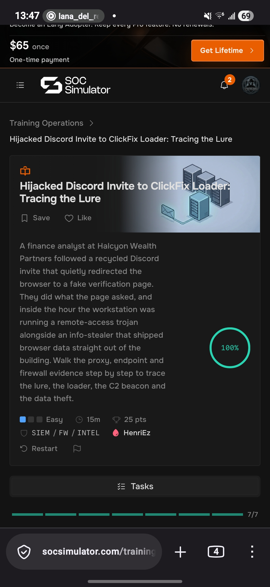

# SOC Simulator: Hijacked Discord Invite to ClickFix Loader

## Overview
This repository contains my documented solution and investigation notes for the **"Hijacked Discord Invite to ClickFix Loader: Tracing the Lure"** training operation on **SOC Simulator**. As a self-taught cybersecurity student, I completed this lab to build practical skills in threat analysis, log investigation, and Security Operations Center (SOC) workflows.

## Lab Details
* **Platform:** SOC Simulator
* **Operation:** Hijacked Discord Invite to ClickFix Loader: Tracing The Lure
* **Difficulty:** Easy
* **Core Skills:** SIEM, Firewall (FW) Analysis, Threat Intelligence (INTEL)
* **Status:** Completed (100%)

## Scenario Summary
A finance analyst at Halcyon Wealth Partners followed a recycled Discord invite that quietly redirected their browser to a fake verification page. Upon executing the page's prompts, the workstation was compromised within an hour, running a remote-access trojan (RAT) and an info-stealer that exfiltrated browser data

## Investigation Steps & Findings
1. **Tracing the Lure:** Analyzed proxy and firewall logs to trace how the user moved from the Discord invitation link to the malicious verification domain.
2. **Endpoint Monitoring:** Inspected workstation telemetry to identify the execution patterns of the ClickFix loader.
3. **C2 Beacon Detection:** Tracked network traffic to locate outbound Command and Control (C2) beaconing activity.
4. **Data Theft Identification:** Confirmed data exfiltration signatures associated with the info-stealer shipping sensitive browser data out of the network.

## Key Takeaways
* Gained hands-on experience tracing social engineering vectors (Discord lures) using proxy and firewall logs.
* Learned how to identify initial loader execution and map out C2 communication channels.
* Built foundational incident response workflows applicable to entry-level SOC roles.

## Lab Details
* **Platform:** [SOC Simulator]
* **Operation:** [Hijacked Discord Invite to ClickFix Loader: Tracing the Lure](https://www.socsimulator.com/training-operations/discord-invite-hijack-clickfix-loader-walkthrough)
* **Difficulty:** Easy
* **Core Skills:** SIEM, Firewall (FW) Analysis, Threat Intelligence (INTEL)
* **Status:** Completed (100%)

.
---

## SOC Simulator: Bumblebee Returns: The Voicemail VBA Macro

### Lab Details
* **Platform:** SOC Simulator
* **Operation:** Bumblebee Returns: The Voicemail VBA Macro
* **Difficulty:** Easy
* **Core Skills:** XDR, SIEM, Firewall (FW), Email, Threat Intelligence (INTEL)
* **Status:** Completed (100%)

### Scenario Summary
An accounts-payable clerk opened a spoofed voicemail-notification email containing a OneDrive link. A malicious Word macro quietly pulled a loader onto the host, initiating a chain from a phishing message through VBA macro execution, PowerShell, and signed-binary proxy execution to the Bumblebee loader's TLS command-and-control (C2).

### Investigation Steps & Findings
1. **Triage the Alert:** Investigated an anomalous voicemail-notification email pointing to a cloud file-sharing service within the Grove Park Freight & Logistics environment
2. **Execution Analysis:** Traced the VBA macro and PowerShell execution flow triggered by the cloud document.
3. **Proxy & C2 Tracking:** Followed binary proxy execution to isolate the TLS command-and-control communication channels used by the Bumblebee loader.

### Key Takeaways
* Gained hands-on experience analyzing email-based phishing vectors and malicious document attachments.
* Learned how to trace multi-stage execution chains from email artifacts to VBA macros and PowerShell.
* Strengthened incident response skills using XDR and SIEM telemetry for threat hunting.

